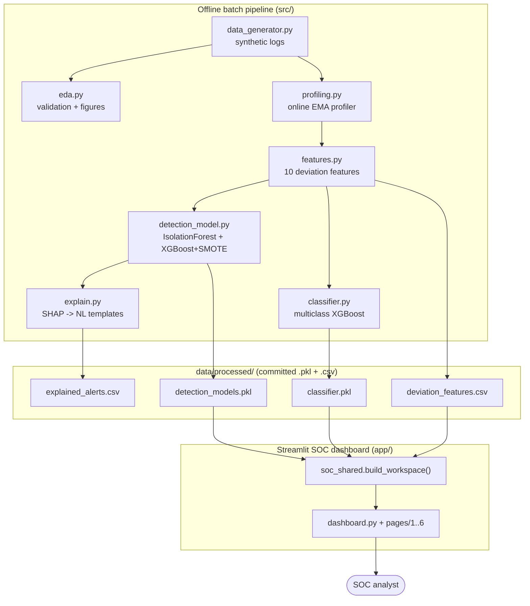
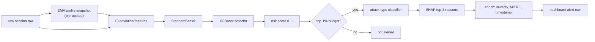
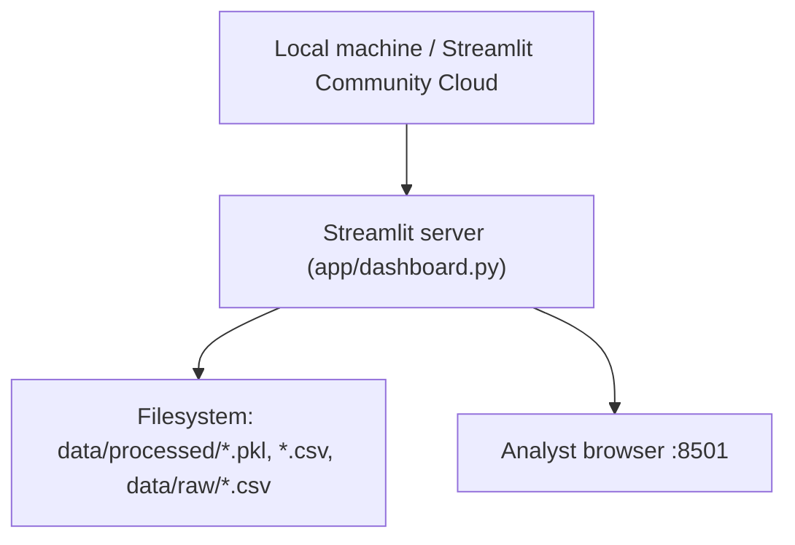

# 🛡️ Sentinel AI — Project Master Guide

> **Purpose of this document.** A beginner-friendly but technically deep, interview-ready
> walkthrough of the Sentinel AI codebase. Everything here is grounded in the actual
> repository files. Where a fact cannot be verified from the code, it is explicitly
> labelled **Inference**, **Recommendation**, or **Unknown / Not Found**.
>
> **Scope note.** This is a documentation-only artifact. No source code, data, notebooks,
> or configuration files were modified to produce it.

---

## Table of Contents

1. [Section 1 — Project at a Glance](#section-1--project-at-a-glance)
2. [Section 2 — The Story Behind the Project](#section-2--the-story-behind-the-project)
3. [Section 3 — Complete Technical Deep Dive](#section-3--complete-technical-deep-dive)
4. [Section 4 — Architecture Diagrams](#section-4--architecture-diagrams)
5. [Section 5 — Technical Design Decisions and Trade-offs](#section-5--technical-design-decisions-and-trade-offs)
6. [Section 6 — Complete Interview Question Bank](#section-6--complete-interview-question-bank)
7. [Section 7 — Top 25 Highest-Priority Interview Questions](#section-7--top-25-highest-priority-interview-questions)
8. [Section 8 — Difficult Questions and Honest Defenses](#section-8--difficult-questions-and-honest-defenses)
9. [Section 9 — Testing, Evaluation, and Evidence](#section-9--testing-evaluation-and-evidence)
10. [Section 10 — Run, Debug, and Modify the Project](#section-10--run-debug-and-modify-the-project)
11. [Section 11 — What I MUST Know Before the Interview](#section-11--what-i-must-know-before-the-interview)
12. [Section 12 — Project Limitations and Improvement Roadmap](#section-12--project-limitations-and-improvement-roadmap)
13. [Section 13 — Interview Cheat Sheet](#section-13--interview-cheat-sheet)
14. [Appendix — Repository Map & Discrepancies Found](#appendix--repository-map--discrepancies-found)

---

## Section 1 — Project at a Glance

### 1.1 The essentials

| | |
|:---|:---|
| **Project title** | Sentinel AI — Behavioral Anomaly Detection for Cybersecurity |
| **One-line description** | An end-to-end classical-ML pipeline that generates synthetic access logs, profiles each entity's normal behavior online, detects anomalous sessions at a SOC-realistic alert budget, classifies the attack type, and explains each alert in plain language through a Streamlit SOC dashboard. |
| **Current status** | **Completed implementation / working MVP** (self-described "Hackathon MVP · v1.1" in `app/soc_shared.py`). All seven phases run end-to-end; trained artifacts and a live demo are committed. |

### 1.2 The real problem it solves

Security Operations Centers (SOCs) drown in access-log volume. A human analyst can only
review a **fixed number of alerts per day**. The hard problem is not "find everything
suspicious" — it is "rank sessions so the few an analyst *can* review are the ones that
matter, and explain *why* each was flagged." Sentinel AI is built around that constraint:
it is evaluated at a **top-1% alert budget**, not at full-dataset accuracy.

### 1.3 Target users

- **SOC analysts** — the dashboard (`app/`) is designed as their triage workspace.
- **Detection/ML engineers** — the `src/` pipeline is the model-building side.
- (For this repository specifically) **an interviewer or reviewer** evaluating the author's
  ML engineering ability.

### 1.4 Why the problem matters

False-positive fatigue is a documented, real operational problem in security teams: if 99%
of alerts are noise, analysts stop trusting the queue and real intrusions slip through.
Framing detection as "precision/recall **at a fixed alert budget**" is the project's central,
defensible idea. *(The business framing is reasonable domain context; the repository does not
contain measured real-world SOC statistics, so treat specific industry numbers as outside
this project's evidence.)*

### 1.5 The proposed solution (as actually implemented)

A seven-phase batch pipeline:

1. **Synthetic data generation** — 250 entities × 45 days, 7 attack types injected at ~2%.
2. **EDA** — class imbalance, per-entity sanity, attack separability, schema validation.
3. **Online EMA profiling** — a per-entity behavioral baseline with cold-start blending.
4. **Feature engineering + detection** — 10 leakage-free deviation features; Isolation Forest
   vs. XGBoost+SMOTE, scored at a top-1% budget.
5. **Attack classification** — multiclass XGBoost on the anomalous subset only.
6. **Explainability** — SHAP TreeExplainer → natural-language alert sentences.
7. **SOC dashboard** — a 7-page Streamlit app over the trained artifacts.

### 1.6 Core features that are actually implemented

- ✅ Seeded synthetic log generator with 7 distinct attack signatures (`src/data_generator.py`).
- ✅ Online EMA entity profiler with cold-start blending and a concept-drift demo (`src/profiling.py`).
- ✅ 10 leakage-free "as-of-just-before-this-session" deviation features (`src/features.py`).
- ✅ Two detection models evaluated at a configurable alert budget (`src/detection_model.py`).
- ✅ Balanced-weight multiclass attack classifier (`src/classifier.py`).
- ✅ SHAP → template explanations with built-in sanity checks (`src/explain.py`).
- ✅ 7-page Streamlit SOC dashboard with live budget slider, SHAP charts, MITRE mapping, CSV export (`app/`).

### 1.7 Inputs → processing → outputs

- **Input:** synthetic behavioral access logs (`data/raw/access_logs.csv`, 66,282 sessions) + held-out labels (`data/labels/labels.csv`).
- **Processing:** profiling → deviation features → detection scoring → classification → SHAP explanation.
- **Output:** ranked, explained alert queue (`data/processed/explained_alerts.csv`) surfaced interactively in the dashboard, plus trained model artifacts (`.pkl`) and EDA/classification figures (`reports/figures/`).

### 1.8 What makes this interesting to an interviewer

- It picks **operationally honest evaluation** (alert budget) over vanity accuracy on an imbalanced set.
- It is rigorous about **data leakage** — features are computed strictly before state updates.
- It solves **cold-start** and **concept drift** explicitly, with a design rationale, not by accident.
- It delivers **explainability analysts can read**, not raw SHAP numbers.
- The author can discuss **why classical ML over deep learning** here — a strong trade-off conversation.

### 1.9 The 30-second explanation

> "Sentinel AI is a behavioral anomaly-detection pipeline for security logs. I generate
> realistic synthetic access logs for 250 entities, learn each entity's normal behavior
> with an online exponential-moving-average profiler, then engineer ten deviation features
> and score every session with XGBoost. I evaluate at a top-1% alert budget — the realistic
> amount an analyst can review — and at that budget the detector flags 134 sessions with
> 100% precision. A second XGBoost model classifies the attack type, and SHAP turns each
> alert into a plain-English reason. Everything is served in a Streamlit SOC dashboard."

### 1.10 Technology stack table

| Component | Technology | Why It Is Used | Alternative | Trade-off |
|:---|:---|:---|:---|:---|
| Language | Python 3.10+ | De-facto ML language; whole stack is Python | — | — |
| Synthetic data | Faker, NumPy, Pandas | No real labelled intrusion data available; need controlled ground truth | Public datasets (e.g. UNSW-NB15) | Full control & reproducibility vs. no real-world noise |
| Profiling | Custom EMA profiler | O(1)/entity online update, drift-aware, cold-start blend | Fixed window, scikit online models | Hand-rolled control vs. more code to maintain |
| Detection (unsupervised) | Isolation Forest (scikit-learn) | Works with no labels — matches production reality | One-Class SVM, LOF | Fast & label-free vs. lower recall here (0.375) |
| Detection (supervised) | XGBoost + SMOTE | Strong tabular performance; SMOTE handles 98/2 imbalance | Random Forest, logistic regression | Best F1 at budget vs. needs labels |
| Imbalance | SMOTE (imbalanced-learn) | Synthetically balance the rare positive class in training only | Class weights, undersampling | Balanced training vs. synthetic rows (train-split only to avoid leakage) |
| Classification | XGBoost + balanced weights | Per-class counts too small/uneven for safe SMOTE | SMOTE, focal loss | Reweight loss vs. no new synthetic minority rows |
| Explainability | SHAP TreeExplainer | Exact, fast attributions for tree models | LIME, permutation importance | Exact tree attributions vs. SHAP-only (tree models) |
| Sequence signal | Per-entity Markov transitions | Lightweight sequential signal without a deep model | LSTM/GRU/Transformer | Cheap & explainable vs. shorter memory |
| Visualization | Plotly, Matplotlib, Seaborn | Plotly for interactive dashboard, MPL/Seaborn for static EDA | Altair, Bokeh | Mature & familiar |
| Dashboard | Streamlit (multipage) | Fastest path from Python to an interactive analyst UI | Dash, Flask+React | Speed vs. less control over layout |
| Threat mapping | MITRE ATT&CK IDs (dict) | Industry-standard technique vocabulary | Custom taxonomy | Recognizable vs. partial mapping (see discrepancy note) |

---

## Section 2 — The Story Behind the Project

### A. The problem story

- **What practical problem inspired it?** SOC analysts face a flood of access-log events and
  a fixed daily review capacity. The useful question is not "is this session weird in the
  abstract?" but "of everything today, which handful should a human look at, and why?"
- **Who experiences it?** Tier-1/2 SOC analysts and detection engineers.
- **Limitations of existing approaches (as framed in the repo):** naive detectors optimize
  accuracy or F1 on the whole dataset, which is misleading when ~98% of rows are normal; and
  raw anomaly scores give analysts no reason to trust an alert.
- **Why worth solving?** Alert fatigue causes missed intrusions. *(This is reasonable domain
  framing; the repo does not include measured incident data — present it as motivation, not
  as a proven result you produced.)*

### B. Interview-ready project introduction

**30-second version** — *(see §1.9)*

**60-second version:**
> "Sentinel AI is an end-to-end behavioral anomaly-detection pipeline for cybersecurity access
> logs. Because real labelled intrusion data is hard to get, I built a seeded synthetic
> generator that produces 66,000 sessions for 250 entities over 45 days and injects seven
> attack types at a realistic 2% rate. I profile each entity's normal behavior online with an
> exponential moving average — which handles both new entities via cold-start blending and
> legitimate behavior change via EMA decay. Then I engineer ten deviation features in a single
> leakage-free chronological pass, and compare an unsupervised Isolation Forest against a
> supervised XGBoost+SMOTE model. The twist is evaluation: I score at a top-1% alert budget
> that mirrors an analyst's real capacity. A second model classifies the attack type, SHAP
> explains each alert in plain English, and a Streamlit dashboard ties it together for an analyst."

**2-minute version:** expand the 60-second version by adding: (1) the leakage discipline —
every feature is read from the profile snapshot *before* that row updates any state; (2) the
specific results — XGBoost+SMOTE reaches 100% precision / 48% recall / 0.65 F1 at the top-1%
budget on the 13,419-session test set, versus 78% / 38% / 0.51 for Isolation Forest; the
classifier exceeds 0.90 F1 on most attack types; (3) the explainability sanity checks — brute-force
alerts mention failed logins, impossible-travel alerts mention travel speed.

**3-minute version:** add the design trade-offs — *why classical ML not deep learning* (tabular
data, small anomaly set, explainability, hackathon timeline), *why Markov over LSTM* (lightweight
sequential signal that still explains), *why SMOTE in detection but class-weights in
classification* (per-class counts too small for safe SMOTE), and the honest limitations
(synthetic data, EMA not attack-resistant on its own, Markov short memory).

### C. Why I chose this project *(proposed narrative — personalize honestly)*

> The code shows genuine engineering depth, so a truthful "why" can emphasize: wanting to work
> on an **imbalanced, sequential, real-world-shaped** problem; learning to **design evaluation
> around an operational constraint** rather than defaulting to accuracy; and practicing
> **leakage-safe feature engineering** and **explainability**. *(These are reasonable
> motivations the code supports; state them as your own only if true.)*

### D. Why this technology stack? — see the trade-off table in [§1.10](#110-technology-stack-table) and [Section 5](#section-5--technical-design-decisions-and-trade-offs).

### E. What makes the project valuable?

- **Implemented capabilities (verifiable):** the full 7-phase pipeline runs; artifacts and a
  live Streamlit demo exist; metrics are reproducible from committed `.pkl` files.
- **Potential benefits (reasonable, not yet measured on real data):** reduced analyst noise via
  budget-based ranking; faster triage via natural-language explanations.
- **Unverified real-world impact:** no claim of deployment, real-incident detection, or measured
  analyst time savings is supported by the repo — do not assert these.

---

## Section 3 — Complete Technical Deep Dive

### A. System overview (plain language)

Imagine giving every user, service account, and device a "usual behavior" fingerprint: when
they log in, from where, how long their sessions last, which resources they touch. Sentinel AI
learns that fingerprint from history, then for each new session measures *how far it deviates*
along ten axes. A machine-learning model turns those deviations into a single risk score, the
riskiest 1% become alerts, a second model guesses *what kind* of attack each looks like, and a
final layer writes a one-sentence reason an analyst can read.

### B. End-to-end execution flow

**Offline / training (run once, in order):**

1. `python src/data_generator.py` → builds 250 entity profiles, generates normal sessions, injects
   7 attack types, writes `data/raw/access_logs.csv` + `data/labels/labels.csv`.
2. `python src/eda.py` → prints class imbalance / separability, saves figures to `reports/figures/`.
3. `python src/profiling.py` → runs the online EMA profiler over all sessions, writes
   `data/processed/entity_profiles.csv` (and an `entity_profiler.pkl`, see discrepancy note).
4. `python src/features.py` → single chronological pass building `data/processed/deviation_features.csv`.
5. `python src/detection_model.py` → trains Isolation Forest + XGBoost+SMOTE, evaluates at top-1%,
   picks the primary model, writes `data/processed/detection_models.pkl`.
6. `python src/classifier.py` → trains the multiclass attack classifier, writes `data/processed/classifier.pkl`
   + confusion matrix / per-class CSV.
7. `python src/explain.py` → SHAP on top-1% alerts, writes `data/processed/explained_alerts.csv`.

**Online / serving (the dashboard):**

8. `streamlit run app/dashboard.py` → `configure_page()` injects CSS; `get_workspace()` calls the
   cached `build_workspace(budget)` in `app/soc_shared.py`, which loads the `.pkl` artifacts, slices
   the test set, re-scores and re-ranks at the current budget, runs the classifier + SHAP on the
   alert rows, and returns one big `workspace` dict. Every page (`app/pages/*.py`) is a thin wrapper
   that calls `get_workspace()`, `render_sidebar()`, and a few `render_*` helpers from `soc_shared.py`.
9. Moving the sidebar **Alert Budget** slider calls `_save_budget()` → updates `st.session_state["soc_budget"]`
   → `build_workspace` re-runs (cache keyed by budget) → all pages recompute precision/recall/queue.

### C. Component-by-component explanation

> File references use repo-relative paths. Function/class names are exact.

#### `src/data_generator.py` — Phase 1, synthetic data
- **Purpose:** produce labelled, reproducible behavioral logs with realistic normal + attack patterns.
- **Key functions:** `build_entities(n=250)` (per-entity profile sampling — home city, login-hour
  Gaussian, resource subset, Dirichlet auth probs, device fingerprint); `gen_normal_sessions()`
  (Poisson sessions/day, per-day travel decision to avoid within-day city flips); seven
  `inject_*` functions (`inject_brute_force`, `inject_impossible_travel`, `inject_credential_stuffing`,
  `inject_device_spoofing`, `inject_lateral_movement`, `inject_low_and_slow_exfil`, `inject_insider_drift`);
  `generate_dataset()` orchestrates, sorts by timestamp, assigns `session_id`, splits features vs. labels.
- **Inputs/outputs:** no input; returns `(features_df, labels_df, profiles)`; `__main__` writes CSVs.
- **Implementation choices:** `SEED=42` everywhere (NumPy Generator, `random`, `Faker`) for full
  reproducibility; `auth_success` added beyond the brief because brute force/credential stuffing are
  undefined without a pass/fail signal.
- **Edge cases / limitations:** attacker rows use `lat/lon = NaN` and `"unknown"` geo; incident counts
  scale off `n_normal // k` heuristics (not calibrated base rates). ⚠️ The `__main__` block writes to
  **hardcoded Linux paths** (`/home/claude/...`) — see [discrepancies](#appendix--repository-map--discrepancies-found).

#### `src/eda.py` — Phase 2, exploratory analysis
- **Purpose:** validate the generated data and show attacks are separable from normal.
- **What it does:** class-imbalance table; per-entity login-hour/resource sanity plots; four
  separability panels (auth-success rate, log session duration, off-hours rate, rows-per-IP burst);
  schema-completeness check vs. the required field list; null-rate report.
- **Outputs:** `reports/figures/entity_profile_sanity.png`, `reports/figures/attack_separability.png`, stdout tables.
- **Note:** this is a flat script (runs on import), not a function library.

#### `src/profiling.py` — Phase 3, online EMA profiler
- **Purpose:** learn and maintain each entity's behavioral baseline online.
- **Key class `EntityProfiler`:** `_init_entity()` seeds a new entity from the population profile;
  `confidence()` = `min(n_obs / K, 1.0)` with `K=15`; `get_effective_profile()` returns a cold-start
  **blend** `c·personal + (1-c)·population` (call *before* `update()` to avoid leakage); `update()`
  applies EMA (`ALPHA=0.15`) to hour mean/var, duration mean/var, and categorical freq dicts;
  `final_table()` exports the per-entity summary.
- **Helpers:** `build_population_profiles(df)` (per-`entity_type` fallback), `_ema_dict_update()`
  (EMA over a categorical distribution), `demo_cold_start()` / `demo_drift()` (qualitative proofs).
- **Documented limitation (in the module docstring):** EMA is **not attack-resistant** — a sustained
  attack slowly pulls the baseline; production should gate updates on the detector's risk score.

#### `src/features.py` — Phase 4.1, deviation features
- **Purpose:** turn raw sessions into 10 numeric deviation features, leakage-free.
- **Core function `engineer_features(df)`:** one chronological `itertuples` loop. For each row it reads
  the profile snapshot and Markov probability **before** updating any state, then records the feature row,
  then calls `profiler.update(...)`. Maintains `last_session` (geo velocity via Haversine), `markov_counts`
  (per-entity prev→next resource), `ip_failure_times` (deque of failed-auth timestamps per IP, 5-min window).
- **Key safeguards:** `MIN_GAP_HOURS = 2/60` suppresses absurd velocities on sub-2-minute gaps;
  `time_since_last = -1` sentinel for cold start; Markov count updated *after* the feature is read.
- **Output:** `data/processed/deviation_features.csv` (features + merged label).

#### `src/detection_model.py` — Phase 4.2–4.6, detection + evaluation
- **Purpose:** train two detectors and evaluate them the way a SOC cares about.
- **Flow:** `load_data()` builds binary `y = (label != "normal")` and one-hot `entity_type`; 80/20
  **stratified** split; `StandardScaler` fit on train only; **Isolation Forest** (`n_estimators=300`,
  `contamination=0.02`, no labels) and **XGBoost** (`n_estimators=300, max_depth=5, lr=0.08`) trained on
  **SMOTE-resampled training split only**; `eval_at_budget()` marks the top-k by score as positive and
  computes precision/recall/F1; primary model chosen by top-1% F1.
- **Output:** `data/processed/detection_models.pkl` with scaler, both models, `feature_cols`, `primary`,
  `test_idx`, cached `iso_scores` / `xgb_scores` / `y_test` (so the dashboard never retrains).
- **Verified result (recomputed from the committed pickle):** at top-1% (134 alerts on 13,419 test
  sessions, 280 true anomalies) — **XGBoost+SMOTE: precision 1.000, recall 0.479, F1 0.647**
  (134/280 caught); **Isolation Forest: precision 0.784, recall 0.375, F1 0.507** (105/280). `primary = "xgboost"`.

#### `src/classifier.py` — Phase 5, attack-type classification
- **Purpose:** given an already-flagged session, predict which of the 7 attack types it resembles.
- **Flow:** filter to `label != "normal"`; `LabelEncoder`; 75/25 stratified split; per-sample weights
  implementing `class_weight="balanced"` (`len(y)/(n_classes·count_c)`); multiclass XGBoost
  (`objective="multi:softprob"`); classification report + confusion matrix + per-class CSV.
- **Output:** `data/processed/classifier.pkl`, `reports/figures/classification_confusion_matrix.png`,
  `reports/figures/classification_per_class_report.csv`.
- **Verified per-class F1 (from the committed CSV):** brute_force 0.990, credential_stuffing 0.982,
  impossible_travel 1.000, lateral_movement 0.964, insider_drift 0.941, device_spoofing 0.923,
  exfiltration 0.906 (support 153/84/56/28/16/8/6 respectively).

#### `src/explain.py` — Phase 6, explainability
- **Purpose:** translate SHAP values into analyst-readable sentences.
- **Key pieces:** `FEATURE_LABELS` (per-feature lambda templates); `describe_feature()`; `build_explanation()`
  — sorts features by `|SHAP|`, keeps only **positive** (risk-raising) contributions, takes top-3 phrases,
  joins into `"flagged due to ... + ... + ..."`. `main()` runs `shap.TreeExplainer` on the XGBoost detector
  over the top-1% alerts and writes `data/processed/explained_alerts.csv`; built-in sanity checks assert
  brute-force alerts mention failed logins and impossible-travel alerts mention travel speed.

#### `app/soc_shared.py` — the dashboard engine (~1,200 lines)
- **Purpose:** all shared logic: CSS/theme, artifact loading, the `build_workspace` computation, sidebar
  navigation, and every `render_*` / `build_*` chart helper.
- **Key functions:** `configure_page()`/`inject_css()`; `load_artifacts()` (`@st.cache_resource`);
  `current_alert_budget()` / `_save_budget()` (budget persistence via a dedicated session-state key so
  Streamlit's widget-reset cycle can't clobber it); `build_workspace(budget_pct)` (`@st.cache_resource`,
  the heart — loads models, slices `test_idx`, ranks top-k, runs classifier + SHAP, builds the enriched
  alert table and severity counts); `render_sidebar()`; `enrich_alert_presentation()` (severity from score,
  timestamps, display strings); `build_shap_chart()`, `build_entity_timeline()`, `build_roc_figure()`,
  `build_confusion_figure()`, `build_gauge()`, `render_investigation_panel()`, `render_settings()`, etc.
- **Severity mapping:** `severity_from_score()` → Critical ≥0.90, High ≥0.75, Medium ≥0.55, else Low.
- **MITRE:** `MITRE_MAPPING` dict + `mitre_for_attack()` with a generic fallback. ⚠️ Keys don't fully
  match the generator's labels — see [discrepancies](#appendix--repository-map--discrepancies-found).

#### `app/dashboard.py` + `app/pages/1..6_*.py`
- `dashboard.py` is the entry point (KPI cards, threat trend, severity overview, recent alerts).
- Each `pages/*.py` is a **thin wrapper**: `configure_page` → `get_workspace` → `render_sidebar` →
  page-specific `render_*`. The real logic lives in `soc_shared.py`.

### D. Code walkthrough — the functions you must be able to defend

**1. Leakage-free feature pass — `engineer_features` (`src/features.py:37`)**
- *What:* builds all 10 features in one chronological loop. *Why:* in production a detector only sees the
  past; computing a feature from a profile that already absorbed the current row would be cheating.
- *How:* read `profiler.get_effective_profile()` and Markov prob **before** `profiler.update()`; `last_session`,
  `markov_counts`, `ip_failure_times` all updated after the feature is recorded.
- *Alternatives:* vectorized groupby features (faster but easy to leak future info); a feature store.
- *What could go wrong:* an off-by-one (updating before reading) silently inflates performance.
- *Interviewer modification:* "Add a feature for failed logins in the last **hour** as well as 5 minutes"
  → add a second deque with a 60-min window.

**2. Budget-based evaluation — `eval_at_budget` (`src/detection_model.py:48`)**
- *What:* mark the top `budget·N` sessions by score as positive, then compute precision/recall/F1.
- *Why:* accuracy/F1 on a 98/2 set is dominated by the majority class; a SOC only reviews a fixed slice.
- *How:* `np.argsort(scores)[::-1][:n_alerts]`. *Gotcha:* ties at the budget boundary are resolved by argsort order.
- *Interviewer modification:* "Evaluate at top-0.5% and top-2%" → the script already sweeps `[0.005, 0.01, 0.02, 0.05]`.

**3. Cold-start blending — `get_effective_profile` (`src/profiling.py:91`)**
- *What:* returns `c·personal + (1-c)·population`, `c = min(n_obs/15, 1)`.
- *Why:* a brand-new entity has no history; scoring it against an empty profile would flag everything.
- *Interviewer modification:* "Make K configurable per entity type" → move `cold_start_k` into the population dict.

**4. Explanation builder — `build_explanation` (`src/explain.py:38`)**
- *What:* top-3 positive-SHAP features → template phrases. *Why:* analysts need reasons, not raw floats.
- *Edge case:* if no feature pushes toward anomaly, returns `"flagged by combined weak signals..."`.

**5. Budget persistence — `_save_budget` / `current_alert_budget` (`app/soc_shared.py:314`)**
- *What:* keeps the slider value in a non-widget session-state key. *Why:* Streamlit resets widget keys
  on page navigation; a dedicated key survives so precision/queue stay consistent across pages.

### E. Data flow (lifecycle of one session)

`raw session row` → (profiling) baseline snapshot → (features) 10-dim deviation vector →
(StandardScaler) scaled vector → (XGBoost) risk score ∈ [0,1] → (budget rank) alert / not →
(classifier) predicted attack type → (SHAP) top-3 reasons → (enrich) severity + timestamp + MITRE →
dashboard row the analyst sees.

### F. Algorithms and core concepts

- **Exponential Moving Average:** `mean += α·(x − mean)`, variance updated as
  `var = (1−α)·(var + α·(x−mean)²)`; `α=0.15`. Recent behavior weighted more → absorbs drift.
  *Worked example:* mean 10.0, new value 20.0 → `10 + 0.15·10 = 11.5`; it moves toward the new value gradually.
- **Haversine distance:** great-circle km between two lat/lon; divided by hours → `geo_velocity_kmh`.
  *Worked example:* Mumbai↔London in 1 h ⇒ ~7,000 km/h, physically impossible → strong anomaly signal.
- **Isolation Forest:** random splits isolate outliers in fewer splits → shorter path length = more anomalous.
- **XGBoost:** gradient-boosted trees; here `max_depth=5`, `lr=0.08`, 300 trees. Outputs a calibrated-ish
  probability used directly as the risk score.
- **SMOTE:** interpolates synthetic minority points between real neighbors (`k=5`); applied **train-only**.
- **Markov transition novelty:** `1 − P(resource | previous resource)` from per-entity counts; high = unusual next action.
- **SHAP (TreeExplainer):** exact Shapley attributions for tree ensembles; per-feature push toward/away from the prediction.
- **Metrics:** precision = TP/(TP+FP) (analyst noise), recall = TP/(TP+FN) (threats caught), F1 = harmonic mean.

*(No RAG/LLM, no database, no auth layer exists in this project — those sections are intentionally omitted
as **Not Applicable**.)*

---

## Section 4 — Architecture Diagrams

### Diagram 1 — High-level system architecture



- **External services:** none — everything runs locally / in-process. The only "external" is the
  committed MITRE technique vocabulary (a static dict, not a service).
- **Data flow direction:** generator → artifacts → dashboard → analyst. The dashboard reads artifacts;
  it never retrains.

### Diagram 2 — Detailed data-flow diagram



### Diagram 3 — Execution sequence (dashboard main use case)

```mermaid
sequenceDiagram
    actor Analyst
    participant Page as dashboard.py / pages/*
    participant Shared as soc_shared.py
    participant Cache as st.cache_resource
    participant PKL as data/processed/*.pkl

    Analyst->>Page: open app / move Alert Budget slider
    Page->>Shared: configure_page(); get_workspace()
    Shared->>Cache: build_workspace(budget)
    alt cache miss (new budget)
        Cache->>PKL: load_artifacts()
        PKL-->>Cache: models + features + raw logs
        Cache->>Cache: rank top-k, classify, run SHAP
    end
    Cache-->>Shared: workspace dict
    Shared-->>Page: render_sidebar + render_* helpers
    Page-->>Analyst: KPIs, queue, SHAP chart, MITRE, actions
```

### Diagram 4 — Deployment architecture

**Current (verifiable):** single-process local run — `streamlit run app/dashboard.py` reads committed
`.pkl`/`.csv` from `data/processed/`. A hosted demo exists at the Streamlit Community Cloud URL in the
README. There is **no** Dockerfile, CI config, or cloud IaC in the repo.



**Proposed future streaming path (from `reports/final_report.md` §10 — NOT implemented):** Kafka/Kinesis
ingestion → Flink/Spark feature engineering → FastAPI/TF-Serving model serving → TimescaleDB/InfluxDB for
profiles → WebSocket dashboard. Clearly mark this as aspirational in interviews.

---

## Section 5 — Technical Design Decisions and Trade-offs

| Decision | Current Approach | Why It Makes Sense | Alternatives | Trade-offs | When I'd Change It |
|:---|:---|:---|:---|:---|:---|
| Evaluation metric | Precision/recall/F1 at **top-1% budget** | Mirrors fixed analyst capacity; accuracy is meaningless at 98/2 | Full-set F1, PR-AUC, ROC-AUC | Budget is a product choice, not fixed by data | If analyst capacity is known in alerts/day, convert budget to a count |
| Synthetic data | Seeded generator, 7 attacks @ ~2% | Full control + reproducible ground truth; no real labelled data | Public IDS datasets | No real-world noise/evasion | For a real deployment, retrain on real logs |
| Profiler | Online EMA + cold-start blend | O(1)/entity, drift-aware, handles new entities | Fixed window, Bayesian online | **Not attack-resistant** (documented) | Gate updates on risk score in prod |
| Detector | XGBoost+SMOTE primary, IF baseline | Best top-1% F1 (0.647 vs 0.507); IF needs no labels | One-Class SVM, autoencoder | Supervised needs labels; synthetic rows from SMOTE | Keep IF for the unlabelled-in-prod reality |
| SMOTE placement | Train split only | Prevents synthetic rows leaking into test | SMOTE before split (wrong) | Slightly less balanced eval | Never change — leakage |
| Classifier imbalance | `class_weight="balanced"` (sample weights) | Per-class counts as low as 6–25; SMOTE unsafe | SMOTE, focal loss | Reweighting can over-favor rare classes | If more data, revisit SMOTE |
| Sequence model | Per-entity Markov transitions | Lightweight, explainable sequential signal | LSTM/GRU/Transformer | Short memory (1 step) | If longer-range patterns matter |
| Explainability | SHAP → NL templates, positive-only | Analyst-readable; suppresses risk-reducing noise | LIME, raw SHAP plots | Template coverage is manual | Add templates as features grow |
| Split strategy | Stratified random 80/20 | Incidents spread across 45 days → fair comparison | Temporal split | Temporal is stricter for real deployment | Switch to temporal for production claim |
| Dashboard | Streamlit multipage + cache | Fastest Python→UI; cache avoids retrain on nav | Dash, Flask+React | Less layout control | For a real product, a proper frontend |
| Artifact reuse | Cache `test_idx` + scores in pickle | Dashboard never retrains; instant budget changes | Recompute live | Pickle couples to library versions (see warnings) | Use `Booster.save_model` / versioned artifacts |

**Documented vs. inferred:** decisions in module docstrings and `reports/final_report.md` are explicitly
the author's (EMA rationale, SMOTE-train-only, budget metric, Markov-vs-LSTM, class-weight rationale).
Lower-level choices (hyperparameter values, severity thresholds) are present in code but not separately
justified — treat those as **implemented choices** rather than documented design arguments.

---

## Section 6 — Complete Interview Question Bank

> Format per question: **Q**, *what's being tested*, **Answer**, *technical detail*, **Likely follow-up**, *follow-up answer*. Grouped by category.

### 1. Project introduction & motivation
1. **Q: Give me a two-minute overview.** *Tests: clarity.* **A:** see §2B. *Detail:* 7 phases, budget metric, SHAP explanations. **Follow-up: What's the single most important idea?** *A:* evaluation at an alert budget, not accuracy.
2. **Q: Why behavioral anomaly detection vs. signature rules?** *Tests: domain understanding.* **A:** signatures catch known attacks; behavioral baselines catch deviations including novel/insider activity. **Follow-up: Then why also inject *known* attack types?** *A:* to have ground truth for evaluation and to train the supervised comparison model.
3. **Q: Is the data real?** *Tests: honesty.* **A:** No — synthetic and seeded; I say so up front. **Follow-up: Doesn't that invalidate results?** *A:* it validates the *pipeline and methodology*, not real-world performance; I'd retrain on real logs.

### 2. Problem statement & use cases
4. **Q: Who uses this and how?** **A:** SOC analysts triaging the ranked, explained queue. **Follow-up: What decision does an alert drive?** *A:* lock account / require MFA / reset creds / monitor / mark benign (the Investigation page actions).
5. **Q: Why is accuracy a bad metric here?** **A:** 98% normal → predict-all-normal scores 98%. **Follow-up: What do you use?** *A:* precision/recall/F1 at a top-1% budget, plus ROC-AUC on the dashboard.
6. **Q: What's the alert budget?** **A:** the top X% of sessions by risk that enter the queue (default 1%, slider 0.1–10%).

### 3. Architecture & system design
7. **Q: Walk the architecture.** **A:** offline `src/` pipeline → committed artifacts → online `app/` dashboard (see Diagram 1).
8. **Q: Why split offline/online?** **A:** training is expensive and batch; serving must be instant, so the dashboard only loads cached artifacts.
9. **Q: How does the dashboard stay fast?** **A:** `@st.cache_resource` on `load_artifacts` and `build_workspace(budget)`; cache keyed by budget so navigation never retrains.
10. **Q: What state is shared across pages?** **A:** the budget (session-state `soc_budget`), selected session, and severity filters; the workspace dict is recomputed from the budget.

### 4. Language/Python fundamentals
11. **Q: Why `itertuples` not `iterrows` in features?** **A:** `itertuples` is far faster and type-stable. **Follow-up: Why loop at all?** *A:* the online profiler is inherently sequential/stateful.
12. **Q: What do `defaultdict`, `Counter`, `deque` give you?** **A:** auto-initialized Markov nests, next-resource counts, and an O(1) sliding failure window.
13. **Q: How is reproducibility enforced?** **A:** `SEED=42` on NumPy Generator, `random`, `Faker`; fixed `random_state` on split/models.

### 5. File-by-file implementation
14. **Q: What does `features.py` guarantee?** **A:** no future leakage — profile read before update. **Follow-up: Prove it.** *A:* `get_effective_profile()` and Markov prob are computed before `profiler.update()` and before incrementing `markov_counts`.
15. **Q: What's in `detection_models.pkl`?** **A:** scaler, both models, feature cols, primary name, `test_idx`, cached scores, `y_test`.
16. **Q: Why cache `test_idx` and scores?** **A:** so the dashboard reproduces the exact evaluation without retraining.
17. **Q: What's the role of `soc_shared.build_workspace`?** **A:** the single function that turns a budget into the full alert workspace (rank, classify, SHAP, enrich).

### 6. Frameworks, libraries, dependencies
18. **Q: Why XGBoost over Random Forest?** **A:** boosting usually edges out bagging on tabular; native `predict_proba` for ranking; fast. **Follow-up: Downside?** *A:* more hyperparameters, easier to overfit.
19. **Q: Why SHAP TreeExplainer specifically?** **A:** exact and fast for tree ensembles vs. approximate LIME.
20. **Q: Why Streamlit?** **A:** fastest Python→interactive-UI for an MVP; downside is limited layout control.
21. **Q: Why imbalanced-learn's SMOTE?** **A:** standard, integrates with the sklearn pipeline; `k_neighbors=5`.

### 7. Algorithms & core concepts
22. **Q: Explain EMA and your α.** **A:** recency-weighted mean; `α=0.15` → ~moderate adaptation. **Follow-up: Effect of α=0.9?** *A:* profile chases noise, more false positives; α too small ignores real drift.
23. **Q: How does Isolation Forest score anomalies?** **A:** shorter isolation path = more anomalous; `contamination=0.02` matches the ~2% rate.
24. **Q: What is transition novelty?** **A:** `1 − P(resource|prev resource)` per entity; unusual next-action → higher.
25. **Q: Why Haversine with a 2-minute floor?** **A:** real great-circle speed; the floor stops jitter over near-zero time producing absurd velocities.
26. **Q: What does SHAP give beyond feature importance?** **A:** per-*instance*, signed attributions — why *this* session scored high.

### 8. Database / APIs / data flow
27. **Q: Where's the database?** **A:** none — CSV/pickle on disk; appropriate for a batch MVP. **Follow-up: What would you add?** *A:* a time-series DB for profiles in a streaming version.
28. **Q: Any REST API?** **A:** no — the dashboard calls Python functions in-process. **Follow-up: How would you expose detection as a service?** *A:* wrap the scorer in FastAPI, load the pickle once, POST a session → risk+explanation.

### 9. AI/ML concepts
29. **Q: How do you prevent data leakage?** **A:** profile-before-update in features; SMOTE on train only; scaler fit on train only.
30. **Q: Overfitting risk?** **A:** `max_depth=5`, moderate `lr`, 300 trees; stratified split; synthetic data is "clean" so real overfitting risk is masked.
31. **Q: Why class weights not SMOTE in the classifier?** **A:** classes as small as 6 test rows — too few neighbors to interpolate safely.
32. **Q: Is the 100% precision real?** **A:** it's real *on this seeded synthetic test set at top-1%*; on real noisy data I'd expect it to drop. State it that way.

### 10. Evaluation / metrics / testing
33. **Q: What's your headline number?** **A:** XGBoost+SMOTE at top-1%: precision 1.000, recall 0.479, F1 0.647 (verified from the pickle).
34. **Q: Why recall only 48%?** **A:** a 1% budget physically can't hold all 2% anomalies; recall rises as budget rises (the script sweeps budgets).
35. **Q: How is the classifier evaluated?** **A:** per-class precision/recall/F1 + confusion matrix on a 25% stratified split.
36. **Q: Automated tests?** **A:** no unit-test suite; validation is the EDA checks + the SHAP sanity assertions in `explain.py`. Be honest about this.

### 11. Debugging & error handling
37. **Q: Where are the fragile spots?** **A:** hardcoded Linux paths in `data_generator.__main__`; pickle library-version coupling (sklearn/xgboost warnings).
38. **Q: NaN handling?** **A:** attacker rows have NaN lat/lon; features guard with `np.isnan`; models get `.fillna(0)`.
39. **Q: What happens if an entity is brand new at scoring time?** **A:** cold-start blend leans on the population profile; `time_since_last = -1`.

### 12. Performance & optimization
40. **Q: Biggest cost in the dashboard?** **A:** SHAP over alert rows; mitigated by caching and only explaining the top-k.
41. **Q: Would the feature pass scale?** **A:** it's single-pass O(N) and O(1)/entity memory — streaming-friendly; the Python loop is the constant-factor bottleneck.

### 13. Security / privacy / reliability
42. **Q: Any secrets in the repo?** **A:** none — all data is synthetic; no keys/tokens.
43. **Q: Could the profiler be poisoned?** **A:** yes — sustained attacks pull the EMA; documented; fix is risk-gated updates.

### 14. Deployment / environment
44. **Q: How is it deployed?** **A:** local `streamlit run`, plus a Streamlit Community Cloud demo; no Docker/CI.
45. **Q: Dependency pinning?** **A:** `requirements.txt` uses `>=` (not exact), which caused the sklearn 1.8→1.9 pickle warning; I'd pin exact versions.

### 15. Limitations / failure scenarios
46. **Q: Weakest attack signal?** **A:** `insider_drift` — intentionally near-normal, for FP tuning, not reliable detection.
47. **Q: What breaks at 100× data?** **A:** the Python feature loop and in-memory DataFrames; needs Spark/Flink.

### 16. Alternatives & trade-offs — see §5.

### 17. Scalability & production readiness
48. **Q: Is this production-ready?** **A:** no — it's a methodology MVP; §10 of the report lists the streaming path. Honest framing wins here.

### 18. Future improvements — see §12.

### 19. Coding / live modifications
49. **Q: Add a feature for 'distinct resources in last hour'.** **A:** maintain a per-entity timestamped deque of resources, count distinct within 1 h, record before update.
50. **Q: Change the budget metric to a fixed 50 alerts/day.** **A:** replace `n_alerts = len·budget` with a per-day groupby cap.

### 20. Challenging follow-ups — see §8.

*(This bank is deliberately deep rather than padded to a fixed count; add your own personalized intros.)*

---

## Section 7 — Top 25 Highest-Priority Interview Questions

> For each: the question, a 30–60s spoken answer, the deeper technical note, the likely follow-up, and one mistake to avoid. Tags: **[Must Know] [Important] [Advanced]**.

1. **[Must Know] Give me the 2-minute overview.** — *Answer:* §2B. *Deeper:* emphasize the budget metric. *Follow-up:* most important idea? *Mistake:* reciting features without the "why."
2. **[Must Know] Why evaluate at a top-1% alert budget?** — *Answer:* analysts have fixed capacity; accuracy is meaningless at 98/2. *Deeper:* `eval_at_budget` marks top-k by score. *Follow-up:* what budget in prod? *Mistake:* claiming it's a universal metric — it's a product choice.
3. **[Must Know] How do you prevent data leakage?** — *Answer:* profile read before update; SMOTE/scaler on train only. *Deeper:* `features.py` ordering. *Follow-up:* show me the exact line. *Mistake:* saying "I split the data" and stopping.
4. **[Must Know] What are your actual numbers?** — *Answer:* XGBoost top-1%: P 1.000 / R 0.479 / F1 0.647; IF: 0.784 / 0.375 / 0.507. *Deeper:* recomputed from `detection_models.pkl`. *Follow-up:* why recall low? *Mistake:* quoting accuracy.
5. **[Must Know] Why is the data synthetic — doesn't that undermine it?** — *Answer:* it validates methodology, not real performance; I'm explicit. *Follow-up:* what would change on real data? *Mistake:* overclaiming real-world impact.
6. **[Must Know] Explain the EMA profiler.** — *Answer:* recency-weighted online baseline, α=0.15, cold-start blend. *Follow-up:* effect of α. *Mistake:* calling it a simple average.
7. **[Important] Cold-start — how do you score a new entity?** — *Answer:* blend `c·personal + (1−c)·population`, `c=min(n/15,1)`. *Follow-up:* why 15? *Mistake:* saying "I ignore new entities."
8. **[Important] Concept drift — why EMA not a window?** — *Answer:* EMA decays stale behavior smoothly; `demo_drift` shows it. *Follow-up:* downside? *Mistake:* missing the attack-poisoning risk.
9. **[Advanced] Why is EMA a security weakness?** — *Answer:* sustained attacks pull the baseline; fix = risk-gated updates. *Follow-up:* implement the gate. *Mistake:* denying any weakness.
10. **[Must Know] Why XGBoost+SMOTE over Isolation Forest as primary?** — *Answer:* higher top-1% F1 (0.647 vs 0.507). *Follow-up:* why keep IF? *Mistake:* forgetting IF needs no labels (prod reality).
11. **[Important] Why SMOTE only on the training split?** — *Answer:* synthetic rows in test = leakage/inflated metrics. *Follow-up:* where in code? *Mistake:* "SMOTE the dataset then split."
12. **[Important] Why class weights (not SMOTE) in the classifier?** — *Answer:* classes as small as 6–25; too few neighbors for safe interpolation. *Follow-up:* the weight formula. *Mistake:* using SMOTE anyway.
13. **[Must Know] How does SHAP explainability work here?** — *Answer:* TreeExplainer → top-3 positive features → templates. *Follow-up:* why positive-only? *Mistake:* describing generic feature importance.
14. **[Important] What are the 10 features and why each?** — *Answer:* list them (geo velocity, time-since, hour z-score, resource/transition novelty, fingerprint mismatch, trailing failures, confidence, auth, duration). *Follow-up:* which matters most for brute force? *Mistake:* vague "deviation features."
15. **[Advanced] Why Markov instead of an LSTM?** — *Answer:* lightweight, explainable sequential signal; deep model unjustified at this scale/timeline. *Follow-up:* Markov limitation? *Mistake:* claiming it captures long-range patterns.
16. **[Important] Walk the dashboard execution flow.** — *Answer:* Diagram 3. *Follow-up:* how is it fast? *Mistake:* thinking it retrains per page.
17. **[Advanced] How does the budget slider recompute everything consistently?** — *Answer:* `build_workspace` cached by budget; budget stored in a dedicated session-state key. *Follow-up:* why not the widget key? *Mistake:* missing Streamlit's widget-reset gotcha.
18. **[Important] Per-class classifier results?** — *Answer:* most ≥0.92 F1; exfiltration lowest (0.906), impossible_travel 1.000. *Follow-up:* why exfiltration hardest? *Mistake:* quoting a single aggregate.
19. **[Advanced] Stratified random vs temporal split — defend your choice.** — *Answer:* incidents spread across 45 days → stratified is fair for this MVP; temporal is stricter for prod. *Follow-up:* when temporal mandatory? *Mistake:* not knowing temporal is the harder bar.
20. **[Important] What's `insider_drift` and why is it weak?** — *Answer:* near-normal by design, for FP tuning. *Follow-up:* how would you catch it? *Mistake:* treating it as a detection failure.
21. **[Must Know] Which parts did you build vs. libraries?** — *Answer:* generator, profiler, feature pass, evaluation, explanation templates, dashboard logic are mine; models/SHAP/SMOTE are libraries I wired together. *Follow-up:* hardest part you wrote? *Mistake:* claiming to have implemented XGBoost/SHAP.
22. **[Advanced] How would you productionize this?** — *Answer:* Kafka→Flink→FastAPI→time-series DB→WebSocket (report §10, not built). *Follow-up:* first thing you'd add? *Mistake:* presenting it as done.
23. **[Important] How do you know the explanations are trustworthy?** — *Answer:* SHAP is exact for trees + sanity checks (brute force→failed logins, travel→speed). *Follow-up:* a case where it misleads? *Mistake:* "SHAP is always right."
24. **[Advanced] Found-bug question: the MITRE mapping.** — *Answer:* `MITRE_MAPPING` keys `data_exfiltration`/`privilege_escalation` don't match the real labels (`exfiltration`, no priv-esc), so exfiltration alerts fall to the generic fallback. *Follow-up:* how to fix? *Mistake:* claiming full MITRE coverage.
25. **[Must Know] What are the top limitations?** — *Answer:* synthetic data, EMA poisoning, Markov short memory, no tests/DB/CI, library-version pickle coupling. *Follow-up:* which worries you most? *Mistake:* saying "none."

---

## Section 8 — Difficult Questions and Honest Defenses

- **"Why this approach over a deep-learning one?"** Tabular, small anomaly set, explainability requirement,
  hackathon timeline. Tree models + SHAP give strong, *explainable* results; a deep model wasn't justified.
- **"Weakest part of your implementation?"** The EMA profiler is not attack-resistant (documented), and there's
  no automated test suite. I'd add risk-gated profile updates and pytest coverage.
- **"What if an external service fails?"** There are no external services — it's fully local/in-process, so there's
  no network dependency to fail. (That's also a scalability limitation.)
- **"How do you know the output is correct?"** Reproducible metrics from committed artifacts, EDA separability
  checks, and SHAP sanity assertions. I don't claim correctness on real data.
- **"What evidence supports your performance claims?"** The numbers are recomputable from `detection_models.pkl`
  and `classification_per_class_report.csv`. I only cite those.
- **"Edge cases?"** New entities (cold start), NaN geo (attacker rows), sub-2-min gaps (velocity floor), empty
  explanation (weak-signal fallback), ties at the budget boundary.
- **"What breaks if data volume grows 100×?"** The in-memory Pandas + Python feature loop; needs a streaming engine.
- **"What would you change with another week?"** Risk-gated profiling, a pytest suite, pinned dependencies,
  fix the MITRE mapping, and a temporal-split evaluation.
- **"What if the model performs poorly on real data?"** Expected — synthetic data is clean. I'd retrain on real
  logs, re-tune the budget, and likely see precision fall from the synthetic 100%.
- **"Which parts are yours vs. framework?"** See Top-25 Q21 — the orchestration, generator, profiler, feature
  engineering, evaluation harness, explanation layer, and dashboard are mine; the estimators are libraries.
- **"Is this genuinely your implementation or just glue?"** The leakage-safe online feature pass, the EMA
  profiler with cold-start blending, the budget evaluation, and the explanation templates are non-trivial
  original logic — not just calling `.fit()`.
- **"Biggest technical challenge?"** Guaranteeing leakage-free features in a stateful online pass while keeping
  it a single O(N) sweep.
- **"What did you learn beyond a tutorial?"** Designing *evaluation around an operational constraint*, and the
  discipline of profile-before-update. *(Personalize this honestly.)*
- **"Why should this be considered technically meaningful?"** It's an honest, end-to-end system that takes
  imbalance, leakage, cold start, drift, and explainability seriously — the exact issues real detection teams face.

> ⚠️ **Fill-in templates (facts the repo can't establish about you personally):** How long it took; whether it
> was solo or a team; your specific role; whether it was a graded hackathon submission; any real demo feedback.
> Answer these from your own memory — do not invent specifics.

---

## Section 9 — Testing, Evaluation, and Evidence

### What is actually tested / validated
- **EDA validation (`src/eda.py`):** class-imbalance table, per-entity profile sanity, attack separability
  panels, schema-completeness check, null-rate report.
- **SHAP sanity checks (`src/explain.py`):** asserts brute-force alerts mention failed logins and
  impossible-travel alerts mention travel speed.
- **Reproducible metrics:** detection scores and `y_test` cached in `detection_models.pkl`;
  classification metrics in `reports/figures/classification_per_class_report.csv`.

### Verified evidence (safe to cite)
- Dataset: **66,282 sessions**, 250 entities, 45 days, **2.11%** anomaly rate (data dictionary / report).
- Detection @ top-1% (13,419-session test set, 280 anomalies, 134-alert budget): **XGBoost+SMOTE P 1.000 /
  R 0.479 / F1 0.647**; **Isolation Forest P 0.784 / R 0.375 / F1 0.507**; `primary = xgboost`.
- Classification per-class F1 (test split): brute_force 0.990, credential_stuffing 0.982, impossible_travel
  1.000, lateral_movement 0.964, insider_drift 0.941, device_spoofing 0.923, exfiltration 0.906.

### What remains untested
- No unit/integration test suite (no `tests/`, no pytest). No CI.
- No evaluation on real-world data. No temporal-split robustness check. No latency/throughput benchmarks.

### How to reproduce
Run the 7 scripts in order (§10), then `streamlit run app/dashboard.py`. To independently verify detection
metrics without retraining, load `data/processed/detection_models.pkl` and recompute `eval_at_budget` on the
cached `y_test` / `xgb_scores` (this is exactly how the numbers above were produced).

### Recommended test plan (prioritized)
1. **Leakage regression test** — assert a feature row never reflects its own session's profile update.
2. **Generator invariants** — anomaly rate in band; all 7 labels present; no NaN in required fields.
3. **Budget monotonicity** — recall is non-decreasing as budget increases.
4. **Explanation coverage** — every top-k alert gets a non-empty explanation.
5. **MITRE mapping** — every generator label resolves to a non-fallback technique (currently fails for `exfiltration`).

---

## Section 10 — Run, Debug, and Modify the Project

### Prerequisites
- Python 3.10+ and `pip`. Windows/macOS/Linux (the dashboard is OS-agnostic; see the path caveat below).

### Setup (Windows PowerShell, matching this repo)
```bash
python -m venv .venv
.venv\Scripts\activate
pip install -r requirements.txt
```
*(macOS/Linux: `source .venv/bin/activate`.)*

### Run the dashboard (uses committed artifacts — no retraining needed)
```bash
streamlit run app/dashboard.py
```
Opens at `http://localhost:8501`. Use the sidebar **Alert Budget** slider to re-rank the queue live.

### Reproduce the pipeline from scratch (optional)
```bash
python src/data_generator.py
python src/eda.py
python src/profiling.py
python src/features.py
python src/detection_model.py
python src/classifier.py
python src/explain.py
```
> ⚠️ **Path caveat:** `src/data_generator.py`'s `__main__` writes to hardcoded Linux paths
> (`/home/claude/behavioral-anomaly-detection/...`). On Windows this step fails unless you edit those two
> output paths to the relative `data/raw/` and `data/labels/` (the other scripts already use relative paths).
> This is a documentation finding — **do not edit the file as part of this task**; note it for the author.

### Environment variables
None required. No secrets, keys, or tokens are used anywhere in the repo.

### Expected outputs
Trained `.pkl` artifacts + processed CSVs in `data/processed/`, EDA/classification figures in
`reports/figures/`, and the interactive dashboard.

### Common errors & troubleshooting
- **`InconsistentVersionWarning` (sklearn) / XGBoost serialization warning:** artifacts were pickled with
  slightly older library versions than installed. It's a warning, not an error. Fix properly by pinning
  exact versions in `requirements.txt` or regenerating artifacts in your environment.
- **`FileNotFoundError` on data paths:** run scripts from the **project root**, not from `src/` or `app/`.
- **Blank dashboard / missing artifacts:** ensure `data/processed/*.pkl` exist (they're committed; regenerate
  via the pipeline if you cleared them).

### Verify it's working
- Dashboard KPI cards populate; the Live Alerts queue is non-empty; Investigation shows a SHAP chart;
  Analytics shows an ROC curve with AUC. Precision in the sidebar should read 100% at the default 1% budget.

### Five modification exercises (easy → hard) — *do not apply; practice only*
1. **Easy — change default budget to 2%.** Files: `app/soc_shared.py` (`current_alert_budget` default).
   Concept: session state. Verify: sidebar shows "Top 2.0%", more alerts.
2. **Easy–Medium — add a MITRE entry for `exfiltration`.** Files: `app/soc_shared.py` (`MITRE_MAPPING`).
   Concept: dict mapping + the label mismatch bug. Verify: Investigation shows T1041 for exfiltration alerts.
3. **Medium — add an 11th feature (distinct resources in last hour).** Files: `src/features.py` (+ `FEATURE_COLS`
   in `detection_model.py`/`classifier.py`). Concept: stateful online features. Verify: feature appears,
   models retrain, SHAP can cite it.
4. **Medium–Hard — switch detection to a temporal split.** Files: `src/detection_model.py`. Concept: leakage/
   evaluation rigor. Verify: metrics change; compare F1 to the stratified baseline.
5. **Hard — add risk-gated profile updates.** Files: `src/features.py` + `src/profiling.py`. Concept: attack-
   resistant profiling. Verify: a sustained attack no longer shifts the entity baseline.

---

## Section 11 — What I MUST Know Before the Interview

Legend: **L1** explain confidently · **L2** explain technically · **L3** handle challenging follow-ups.

| Topic | Target | Self-check |
|:---|:---:|:---|
| Problem & motivation (alert fatigue, budget) | L1 | ☐ |
| End-to-end 7-phase workflow | L1 | ☐ |
| EMA profiler (α, cold start, drift, poisoning) | L3 | ☐ |
| The 10 deviation features + leakage discipline | L3 | ☐ |
| Budget-based evaluation + the actual numbers | L2 | ☐ |
| IF vs XGBoost+SMOTE, why SMOTE train-only | L2 | ☐ |
| Classifier + class-weight rationale + per-class results | L2 | ☐ |
| SHAP → NL templates (positive-only, sanity checks) | L2 | ☐ |
| Markov transition novelty (and why not LSTM) | L3 | ☐ |
| Dashboard flow + caching + budget persistence | L2 | ☐ |
| Architecture diagram from memory | L1 | ☐ |
| Top design trade-offs (§5) | L3 | ☐ |
| Limitations & known gaps (incl. MITRE bug) | L2 | ☐ |
| Security/failure scenarios (profiler poisoning) | L3 | ☐ |
| Future/production path (report §10) | L1 | ☐ |
| What's mine vs. library | L2 | ☐ |

---

## Section 12 — Project Limitations and Improvement Roadmap

### Confirmed limitations (from code/docstrings/report)
- Synthetic data — no real log noise, clock skew, or adversarial evasion.
- EMA profiler is not attack-resistant on its own.
- Markov features capture only one-step dependencies.
- `insider_drift` is intentionally near-undetectable.
- No automated tests, no database, no API, no Docker/CI.
- Pickle artifacts are coupled to library versions (`>=` pins → version-drift warnings).

### Potential risks needing testing
- 100% precision at top-1% may be optimistic beyond this seeded synthetic set.
- Stratified-random split may be more forgiving than a temporal split would be.

### Features referenced but not implemented (discrepancies)
- `MITRE_MAPPING` references `data_exfiltration` and `privilege_escalation`; the generator emits
  `exfiltration` and has no privilege-escalation type → exfiltration alerts get the generic fallback technique.
- `src/profiling.py` writes `entity_profiler.pkl`, but it isn't committed in `data/processed/` and isn't
  loaded anywhere (features.py rebuilds the profiler). Harmless, but worth noting.

### Improvement roadmap

**Quick wins** — pin exact dependency versions (`requirements.txt`); fix the two hardcoded paths in
`data_generator.__main__`; add the `exfiltration`/`privilege_escalation` MITRE keys. *Difficulty: low.
Benefit: reproducibility + correct dashboard labels. Measure: clean reinstall runs end-to-end; Investigation
shows T1041.*

**Medium-effort** — add a pytest suite (leakage regression, generator invariants, budget monotonicity);
switch detection to a temporal split and report both; parameterize `K`/`α` per entity type.
*Difficulty: medium. Benefit: trust + rigor. Measure: tests pass in CI; documented metric delta.*

**Advanced / production** — risk-gated profile updates (attack-resistant EMA); a FastAPI scoring service;
a streaming path (Kafka→Flink→time-series DB→WebSocket) per report §10; swap Markov for a sequence model if
longer-range patterns prove valuable. *Difficulty: high. Benefit: real-time, poisoning-resistant detection.
Measure: streaming latency, recall at fixed budget on real logs.*

> No full rewrite is warranted — the architecture is sound; these are targeted upgrades.

---

## Section 13 — Interview Cheat Sheet

- **One-liner:** End-to-end behavioral anomaly-detection pipeline for security logs, evaluated at a SOC-realistic alert budget with SHAP explanations and a Streamlit dashboard.
- **30-second intro:** §1.9.
- **Problem → Solution → Architecture → Result:** alert fatigue on imbalanced logs → online profiling + deviation features + budget-ranked detection + attack classification + SHAP explanations → offline `src/` pipeline feeding an online `app/` dashboard → XGBoost 100% precision / 48% recall / 0.65 F1 at top-1%.
- **Stack & why:** Python; XGBoost (tabular strength); Isolation Forest (label-free baseline); SMOTE (imbalance, train-only); SHAP (exact tree attributions); custom EMA profiler (drift + cold start); Streamlit (fast UI).
- **Workflow (steps):** generate → EDA → profile → features → detect → classify → explain → dashboard.
- **Five most important files:** `src/features.py`, `src/detection_model.py`, `src/profiling.py`, `src/explain.py`, `app/soc_shared.py`.
- **Ten key terms:** alert budget, EMA, cold-start blending, concept drift, data leakage, SMOTE, Isolation Forest, SHAP, Markov transition novelty, precision/recall@budget.
- **Five design decisions:** budget metric; SMOTE train-only; class-weights in classifier; Markov over LSTM; stratified split (§5).
- **Five limitations (honest):** synthetic data; EMA poisoning; Markov short memory; no tests/CI; MITRE label mismatch.
- **Metrics (verified):** detection top-1% — XGB P1.000/R0.479/F1 0.647, IF 0.784/0.375/0.507; classifier per-class F1 0.906–1.000.
- **Three things to never claim without evidence:** real-world deployment/impact; measured analyst time savings; that 100% precision holds on real data.
- **"Why be interested?":** "It takes the unglamorous-but-real problems — imbalance, leakage, cold start, drift, explainability — seriously, and measures success the way a SOC actually operates."

---

## Appendix — Repository Map & Discrepancies Found

### Repository map (most important first)

| File / Dir | Purpose | Key functions/classes | How it connects |
|:---|:---|:---|:---|
| `app/soc_shared.py` | Dashboard engine: data load, workspace build, all render/chart helpers | `build_workspace`, `load_artifacts`, `render_sidebar`, `build_shap_chart`, `enrich_alert_presentation`, `MITRE_MAPPING` | Imported by every page; reads `data/processed/*.pkl` + `src/explain.py` |
| `src/features.py` | Leakage-free 10-feature engineering | `engineer_features`, `haversine_km` | Consumes profiler; writes `deviation_features.csv` used by detection/classifier |
| `src/detection_model.py` | Train + evaluate detectors at budget | `load_data`, `eval_at_budget`, `main` | Writes `detection_models.pkl`; feeds dashboard + explain |
| `src/profiling.py` | Online EMA profiler | `EntityProfiler`, `build_population_profiles`, `_ema_dict_update` | Used by `features.py`; writes `entity_profiles.csv` |
| `src/explain.py` | SHAP → NL explanations | `build_explanation`, `describe_feature`, `FEATURE_LABELS` | Imported by dashboard; writes `explained_alerts.csv` |
| `src/classifier.py` | Multiclass attack classifier | `main` (label-encode, weighted XGBoost) | Writes `classifier.pkl` + per-class CSV; used by dashboard |
| `src/data_generator.py` | Synthetic log generation | `build_entities`, `gen_normal_sessions`, 7×`inject_*`, `generate_dataset` | Produces `access_logs.csv` + `labels.csv` |
| `src/eda.py` | EDA validation + figures | flat script | Reads raw logs; writes figures |
| `app/dashboard.py` | Dashboard entry point | — | Home page; calls `soc_shared` |
| `app/pages/1..6_*.py` | Live Alerts, Investigation, Entity Search, Analytics, Model Health, Settings | thin wrappers | Each calls `get_workspace` + `render_*` |
| `data/raw/`, `data/labels/`, `data/processed/` | Raw logs, held-out labels, artifacts/CSVs | — | Pipeline I/O |
| `reports/` | `final_report.md`, figures, PDF | — | Narrative + evaluation evidence |
| `requirements.txt`, `.gitignore`, `README.md` | Deps, ignores, overview | — | Project metadata |
| `Files/` | Problem statement, tracker, source `.docx`/`.pptx` (git-ignored) | — | Background material, not code |

### Discrepancies & findings (flagged honestly)
1. **MITRE mapping label mismatch** (`app/soc_shared.py`): keys `data_exfiltration`, `privilege_escalation`
   don't match actual labels (`exfiltration`; no priv-esc). Exfiltration alerts fall to the generic
   `("T1078", "Behavioral anomaly / account activity")` fallback.
2. **Hardcoded Linux output paths** in `src/data_generator.py` `__main__` (`/home/claude/...`) — the regen
   step fails on Windows without editing them; all other scripts use relative paths.
3. **`entity_profiler.pkl`** is written by `profiling.py` but not committed and not loaded anywhere.
4. **Dependency pinning**: `requirements.txt` uses `>=`, producing sklearn/XGBoost version-drift warnings
   when unpickling committed artifacts (works, but warns).
5. **Label naming**: README/report say "Data Exfiltration" while the code label is `exfiltration` — cosmetic
   but feeds finding #1.

### Files inspected vs. not
- **Fully inspected:** all of `src/*.py`, all of `app/*.py` + `app/pages/*.py`, `README.md`,
  `reports/final_report.md`, `data/raw/data_dictionary.md`, `reports/figures/classification_per_class_report.csv`,
  `requirements.txt`, `.gitignore`, and (data-level spot checks) the processed CSVs + `detection_models.pkl`.
- **Not opened in depth (binary/large, inspected only at metadata level):** `data/raw/access_logs.csv` (13 MB —
  schema confirmed via dictionary + head), the `.pkl` internals beyond keys/metrics, `reports/figures/*.png`,
  and the `Files/*.docx`/`*.pptx` binaries (git-ignored background material).

### Questions only the author can answer
- Time taken, solo vs. team, your exact role, hackathon/grade context, and any real demo feedback.
- Whether the Streamlit Community Cloud demo link is currently live.
- Intended fix for the MITRE mapping and the hardcoded paths (left unmodified per the safety rule).

---

*Generated as a documentation-only artifact. No source files were modified. All metrics cited are either
read directly from committed files or recomputed from committed artifacts without retraining.*
